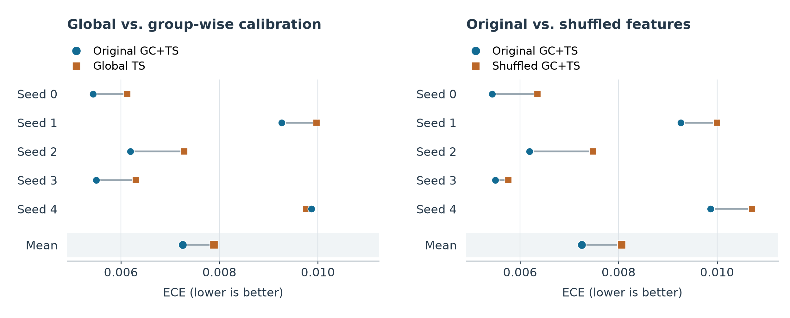

# Group calibration and feature correspondence

Does group calibration benefit from matching each example to its own internal features? This repository evaluates that question using a fixed CIFAR-10 / ResNet-152 classifier and the authors' cached features, logits, and labels.

It accompanies a CSCI 567 project on Yang, Zhan, and Gan, **Beyond Probability Partitions: Calibrating Neural Networks with Semantic Aware Grouping** (NeurIPS 2023). [Paper](https://proceedings.neurips.cc/paper_files/paper/2023/file/b693a240cf1009bff9fa4422141c9392-Paper-Conference.pdf) · [Author code](https://github.com/ThyrixYang/group_calibration)

## 1. Read the reported results

The committed CSVs contain the original 20 GPU runs: four conditions, each evaluated with seeds 0–4. Values below are means ± sample standard deviation (`ddof=1`); lower ECE and NLL are better.

| Method | ECE | NLL |
|---|---:|---:|
| Uncalibrated | 0.024763 ± 0.000547 | 0.173049 ± 0.002638 |
| Global temperature scaling (TS) | 0.007889 ± 0.001860 | 0.144950 ± 0.001370 |
| Group calibration + TS (GC+TS) | 0.007251 ± 0.002144 | 0.143622 ± 0.001840 |
| GC+TS with shuffled features | 0.008059 ± 0.002199 | 0.145304 ± 0.001391 |

GC+TS improves ECE over TS in 4/5 paired runs. It improves both ECE and NLL over shuffled GC+TS in 5/5. These results support a contribution from sample–feature correspondence in this setting. All methods retain the original predicted classes; mean accuracy is 95.7822%.

- [Per-seed measurements](results/per_seed.csv)
- [Means and standard deviations](results/summary.csv)
- [Paired differences](results/paired_differences.csv) and [their summaries](results/paired_summary.csv)
- [Data hashes, run provenance, and release validation status](results/provenance.json)

Each seed repeats the split and calibration of the same fixed classifier. Positive paired differences mean GC+TS has the smaller error: `delta_gc = TS − GC+TS`; `delta_feature = shuffled GC+TS − GC+TS`.



## 2. Recreate the figures

Use Python 3.11 or 3.12. This installs an isolated analysis environment without PyTorch or the model caches:

```bash
bash code/setup.sh --analysis
source .venv-analysis/bin/activate
python code/plot.py --input results/per_seed.csv --output figures
```

The plot command writes PNG, SVG, and PDF. Titles and labels default to English. `--labels path/to/labels.json` accepts external labels; `--formats png pdf` selects formats.

## 3. Reproduce the GPU experiments

### Install

Use Linux, Python 3.11, and a CUDA-compatible NVIDIA driver. Installation can run before requesting a GPU:

```bash
bash code/setup.sh --gpu
source .venv-gpu/bin/activate
```

`PROJECT_PYTHON=/path/to/python3.11 bash code/setup.sh --gpu` selects an interpreter. Setup downloads the authors' repository at commit `1fb9c6bb7b98e3960b3a9281ef25e8fcedfb1a88`, verifies both cache hashes, and installs the recorded Linux/CUDA environment. The original runs used Python 3.11.9, PyTorch 2.4.1+cu118, and a Tesla V100 32 GB. See [third-party attribution](THIRD_PARTY.md).

### Run inside a Slurm GPU allocation

Request one GPU using your cluster's account and partition settings. The runner uses the allocation's logical `cuda:0` and stops if CUDA or the allocation checks fail.

```bash
python code/preflight.py
python code/run.py --level smoke --method gc_ts --seeds 0 \
  --manifest-out outputs/smoke_manifest.json
python code/run.py --level main --method all --seeds 0 1 2 3 4 \
  --manifest-out outputs/main_manifest.json
```

Run the main batch only after smoke succeeds. Each manifest contains only attempts started by its command, including failed attempts, and an existing manifest cannot be overwritten. New attempts receive new directories and retain their logs. A smoke run uses 2 partitions and at most 5 group-optimization iterations; main uses the full settings below. An optional `--level pilot` runs GC+TS with full settings at seed 0.

### Summarize and validate

```bash
python code/summarize.py --manifest outputs/main_manifest.json \
  --output outputs/reproduced
python code/validate.py --manifest outputs/main_manifest.json \
  --summary outputs/reproduced
python code/plot.py --input outputs/reproduced/per_seed.csv \
  --output outputs/reproduced/figures
```

Summarization requires exactly the 20 completed main combinations, consistent source/data provenance, paired splits, and paired GC initialization. It rejects duplicate completed attempts. `--allow-partial` is available for explicitly inspecting an incomplete batch; it does not make that batch complete.

Validation audits the saved predictions, cache hashes, split and shuffle indices, initialization, optimizer observations, metrics, and summary CSVs. It runs on CPU inside the installed GPU environment and writes a separate JSON report. Pass a new `--output` path to choose its location. It never overwrites an audit report. Recomputed metrics use absolute tolerance `1e-7`; cross-platform float32 softmax uses `atol=1e-7, rtol=1e-6`.

The original 20 runs are complete. **A fresh GPU run of this reorganized repository remains pending**; the machine-readable status is in `results/provenance.json`. Local software checks and CSV reconstruction are distinct from that GPU revalidation. See [verification details](VERIFICATION.md).

## Protocol

| Item | Setting |
|---|---|
| Conditions | `uncalibrated`, `ts`, `gc_ts`, `gc_ts_shuffle` |
| Seeds | 0, 1, 2, 3, 4 |
| Cached inputs | 2048-dimensional features, 10 logits, and labels |
| Group training (`D_val`) | 5,000 examples from the authors' validation cache |
| Final calibration (`D_cal`) | 1,000 examples from the authors' test cache |
| Evaluation (`D_eval`) | Remaining 9,000 examples from that cache |
| GC settings | 2 groups, 20 partitions, L-BFGS max iterations 100, weight decay 0.1 |
| Metrics | ECE with 15 bins, NLL, accuracy, Brier (sum over classes, mean over examples), changed predicted classes |

GC first learns grouping functions on `D_val`, then refits final group temperatures on `D_cal`. Predictions average the 20 partition probability vectors. The shuffled condition independently permutes feature rows within each split, keeping logits and labels fixed. GC and shuffled GC share each seed's data split and initial grouping weights. Permutations use separate NumPy generators.

The runner preserves the pinned implementation, including its effective optimizer defaults. In that implementation the configured learning-rate field is not passed to L-BFGS. TS NLL is computed from logits; GC NLL uses `log(probability + 1e-10)`, matching the upstream evaluator. No classifier retraining is required.

## Repository layout

```text
code/               setup, run, preflight, summarize, validate, and plot
code/configs/       smoke, pilot, and main settings
code/jobs/          wrapper for an existing Slurm GPU allocation
requirements/       analysis and original Linux/CUDA version locks
results/            original measurements and provenance
figures/            figures generated from the committed measurements
tests/              offline software tests with synthetic fixtures
```

Downloaded upstream code, environments, and generated `outputs/` stay outside Git tracking. A run saves source snapshots, effective configuration, environment and device details, data hashes, split/permutation indices, predictions, optimizer observations, metrics, status, and logs. The original measurements remain in `results/`; re-runs write to `outputs/`.

```bash
python -m unittest discover -s tests -v
```

The tests exercise scheduling, manifests, provenance, paired statistics, and incomplete/duplicate selections without training or GPU access.

## Contributors

- Wei Liu: research question, alternative hypothesis, experiment design, and core interpretation.
- Yuanman Mu: paper reading, method explanation, and evidence review.
- Liuwen Kong: reproduction, environment setup, GPU execution, and checks.
- Jiansong Zhang: statistics, figures, and report integration.
